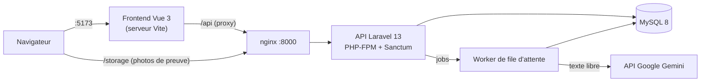
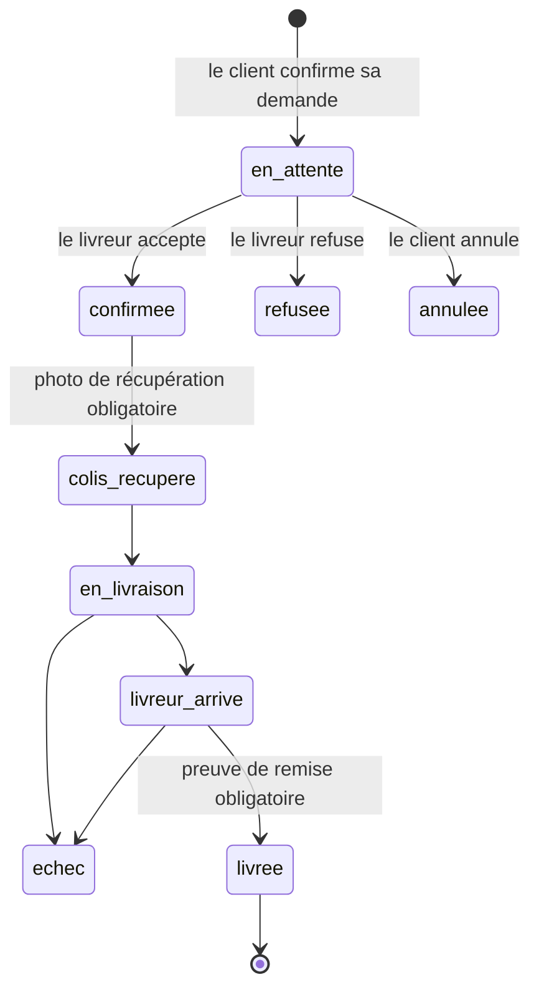
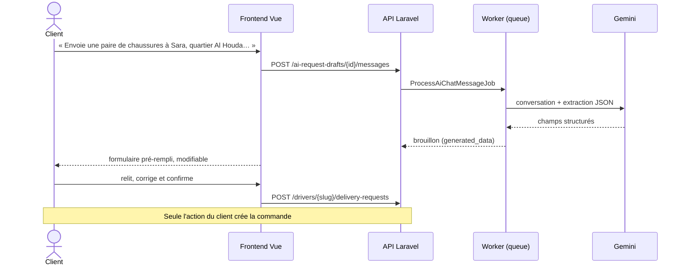
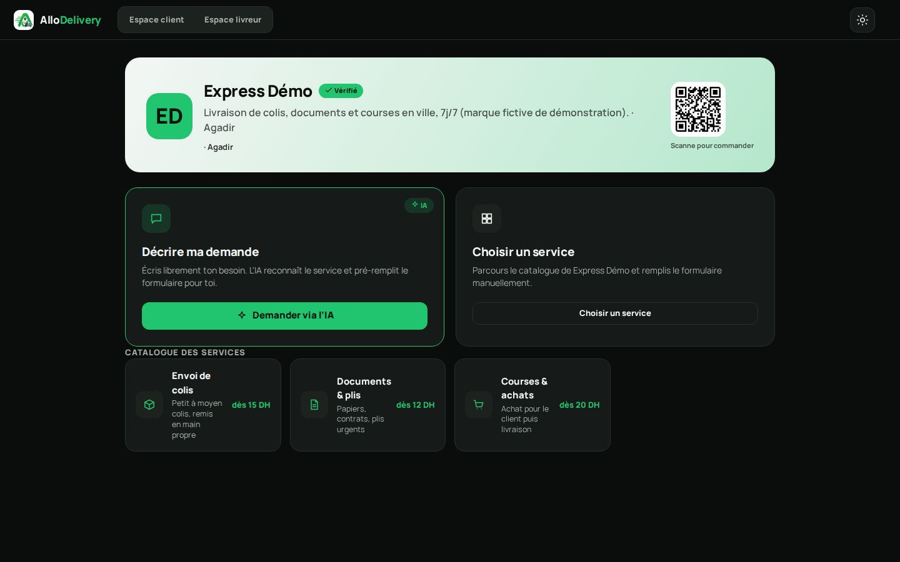
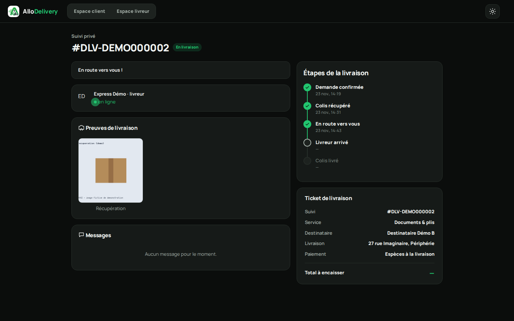
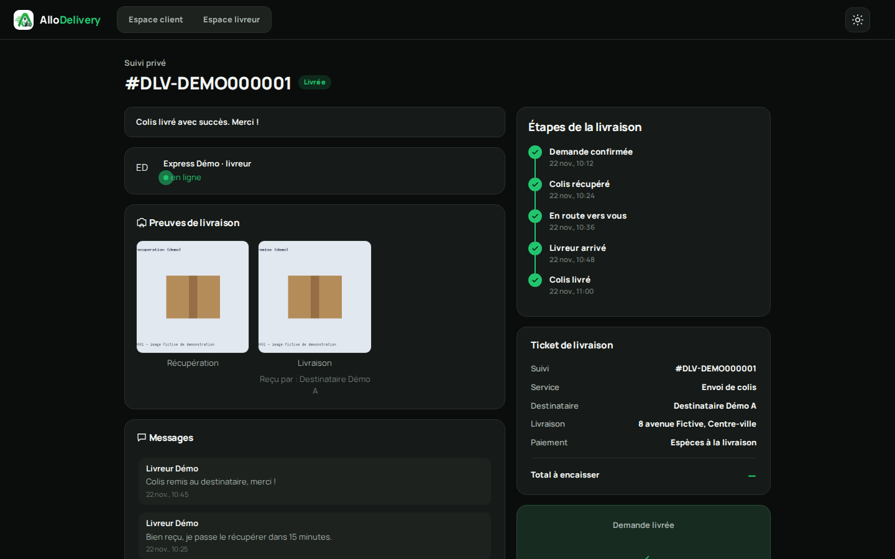
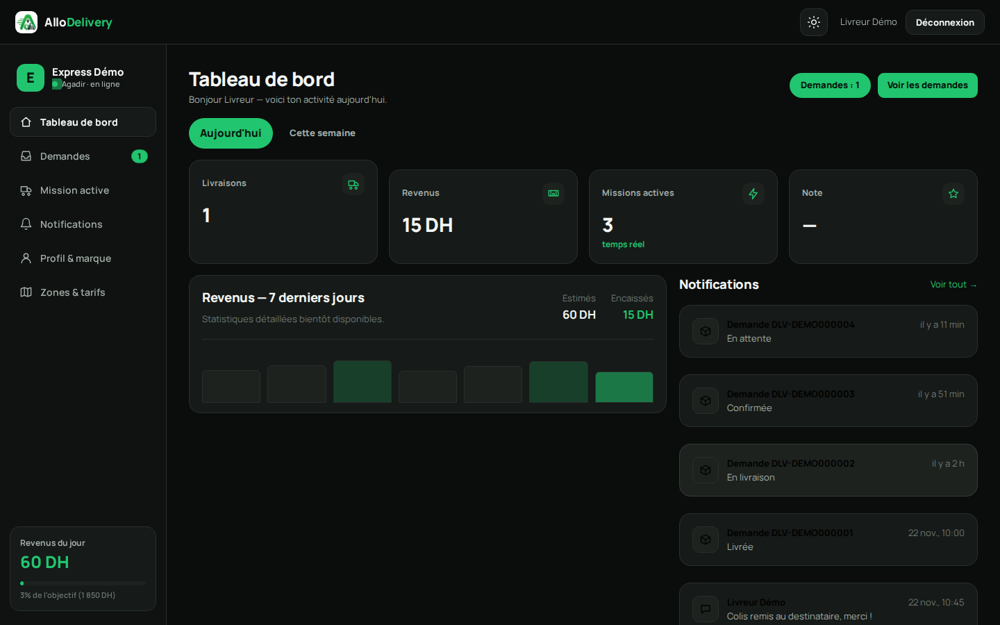

# Allo Delivery

[](https://github.com/Rayantoufella/Allo_Delevry/actions/workflows/ci.yml)

> **EN —** Allo Delivery is a white-label platform for independent couriers: each courier gets a public brand page (slug + QR code), a service catalogue and zone-based pricing.
> Customers place orders (optionally drafted by an AI assistant, always validated by a human) and follow them through a tracked status workflow with delivery proofs and chat.
> Vue 3 + Laravel 13 API secured with Sanctum, MySQL, fully runnable with a single `docker compose up`.

**La plateforme des livreurs indépendants : une marque, un lien, un QR Code, et chaque commande suivie de bout en bout.**

## Le problème

Beaucoup de livreurs indépendants travaillent uniquement par téléphone et WhatsApp. Les commandes arrivent en texte libre, les adresses et montants se perdent dans la conversation, le client ne sait pas où en est son colis, et en cas de litige il n'existe aucune preuve de remise.

## La solution

Allo Delivery donne à chaque livreur-entrepreneur son propre espace :

- une **page publique à sa marque** que ses clients ouvrent par un lien ou un QR Code ;
- un **formulaire de commande structuré**, que l'assistant IA peut pré-remplir à partir du message du client ;
- un **workflow de livraison historisé**, avec preuves photo et chat, consultable par un **lien privé de suivi**.

## Fonctionnalités

**Espace livreur (marque)**
- Profil de marque avec **slug unique** (généré et dédoublonné automatiquement) et **page publique**
- **QR Code** de la page publique (SVG généré côté API)
- **Catalogue de services** (prix de base, activation/désactivation)
- **Zones tarifaires** (zone de départ → zone d'arrivée, prix fixe, activables)
- Tableau de bord (livraisons, revenus, missions actives, notifications)

**Commandes et livraison**
- **Workflow à 6 statuts** sur le parcours nominal : `en_attente → confirmee → colis_recupere → en_livraison → livreur_arrive → livree`, plus les issues `refusee`, `echec` et `annulee` (machine à états : transitions interdites refusées)
- **Historique** de chaque changement de statut (auteur, date, commentaire), écrit dans la même transaction que le statut
- **Preuves** : photo obligatoire à la récupération du colis et preuve obligatoire avant la confirmation de remise
- **Chat** client ↔ livreur sur chaque commande (actualisation par polling)
- **Lien privé de suivi** `/tracking/{jeton}` sans compte : timeline, preuves, derniers messages
- Notifications générées en tâche de fond (file d'attente Laravel)

**Assistant IA (Google Gemini)**
- Le client décrit son besoin en **texte libre** ; l'IA converse puis extrait un **formulaire structuré** (destinataire, adresses, service, zone, montants)
- **Validation humaine obligatoire** : l'IA ne crée jamais de commande. Le client relit, corrige puis confirme lui-même le formulaire
- Traitement asynchrone (job en file d'attente), modèles de secours configurables

**Sécurité**
- API protégée par **Laravel Sanctum** (jetons Bearer), rôles `driver` / `client`
- **Cloisonnement par marque** : un livreur ne voit que ses services, zones et commandes ; un client est rattaché à un seul livreur (policies + tests dédiés)
- Limitation de débit sur l'authentification, le suivi public et l'IA

## Architecture



**Workflow de livraison** (chaque transition est historisée) :



**Assistant IA avec validation humaine** :



## Stack technique

| Couche | Technologies (versions du lockfile) |
|---|---|
| Frontend | Vue 3.5, Vue Router 5, Pinia 4, Axios, Vite 8 |
| Backend | PHP 8.4, Laravel 13, Laravel Sanctum 4, simple-qrcode, Scribe (doc API) |
| Base de données | MySQL 8 (SQLite en mémoire pour les tests) |
| IA | API Google Gemini (appels HTTP depuis un job en file d'attente) |
| Qualité | Pest 4 (86 tests), Laravel Pint, GitHub Actions |
| Infrastructure | Docker Compose : MySQL, PHP-FPM, nginx, worker de queue, Node 22 |

## Démarrage rapide

Prérequis : Docker et Docker Compose. Rien d'autre (ni PHP, ni Node, ni MySQL en local).

```bash
git clone https://github.com/Rayantoufella/Allo_Delevry.git
cd Allo_Delevry
docker compose up -d --build
```

Le premier lancement prend quelques minutes (`composer install`, `npm ci`, migrations, données de démo). Ensuite :

| | URL |
|---|---|
| Application (frontend) | http://localhost:5173 |
| API | http://localhost:8000/api |
| Documentation de l'API | http://localhost:8000/docs/ |

Au premier démarrage, le conteneur `app` exécute automatiquement (et seulement si nécessaire) : copie de `backend/.env`, `key:generate`, `migrate`, seed des données de démo, `storage:link`.

### Comptes de démonstration

Toutes les données sont **fictives**.

| Rôle | Où se connecter | Email | Mot de passe |
|---|---|---|---|
| Livreur | http://localhost:5173/login/driver | `driver@example.com` | `password` |
| Client | http://localhost:5173/drivers/express-demo/login | `client@example.com` | `password` |

- Page publique de la marque : http://localhost:5173/drivers/express-demo
- Suivi d'une commande en cours : http://localhost:5173/tracking/demo-suivi-en-livraison
- Suivi d'une commande livrée (avec preuves) : http://localhost:5173/tracking/demo-suivi-livree

### Commandes utiles

```bash
docker compose ps                       # état des services
docker compose logs -f app queue        # logs du backend et du worker
docker compose logs -f frontend         # logs de Vite
docker compose down                     # arrêter
docker compose down -v                  # arrêter ET supprimer la base de ce projet (réinitialisation)
docker compose --profile tools up -d    # + phpMyAdmin sur http://localhost:8081
```

Après `docker compose down -v`, le prochain `up` recrée la base et les données de démo.

## Tests

```bash
docker compose exec app php artisan test         # 86 tests Pest (SQLite en mémoire, la base de démo n'est pas touchée)
docker compose exec app ./vendor/bin/pint --test # style du code
```

La CI GitHub Actions exécute Pint, les tests, le build du frontend et la validation/le build de la stack Docker.

## Variables d'environnement

Ports exposés (facultatif) : copier `.env.example` en `.env` **à la racine**.

| Variable | Défaut | Rôle |
|---|---|---|
| `FRONTEND_PORT` | `5173` | Frontend Vue |
| `API_PORT` | `8000` | nginx / API Laravel |
| `DB_FORWARD_PORT` | `3307` | MySQL sur l'hôte (127.0.0.1 uniquement) |
| `PMA_PORT` | `8081` | phpMyAdmin (profil `tools`) |

Backend : `backend/.env`, créé depuis `backend/.env.example` (valeurs de démo).

| Variable | Rôle |
|---|---|
| `DB_HOST`, `DB_DATABASE`, `DB_USERNAME`, `DB_PASSWORD` | Connexion MySQL (`db`, `allo_delivery`, `allo` / `allo` en local) |
| `FRONTEND_URL` | URL encodée dans le QR Code (fixée par docker-compose) |
| `QUEUE_CONNECTION` | `database` : jobs traités par le service `queue` |
| `GEMINI_API_KEY` | Clé Google AI Studio pour l'assistant IA (**vide par défaut**) |
| `GEMINI_CHAT_MODEL`, `GEMINI_EXTRACT_MODEL`, `GEMINI_FALLBACK_MODELS` | Modèles utilisés |

**Assistant IA** : sans `GEMINI_API_KEY`, toute l'application fonctionne mais l'assistant affiche une erreur explicite. Pour l'activer, renseigner la clé dans `backend/.env` puis `docker compose restart app queue`. Aucune clé n'est versionnée.

## Captures d'écran

| Page publique de la marque (QR Code) | Suivi d'une livraison en cours |
|---|---|
|  |  |
| **Commande livrée : timeline et preuves** | **Tableau de bord livreur** |
|  |  |

## Structure

```
backend/    API Laravel (app/, routes/api.php, database/, tests/)
frontend/   SPA Vue 3 (src/views, src/components, src/stores)
docker/     Dockerfile PHP, script d'initialisation, configuration nginx
docs/       Captures d'écran
```
